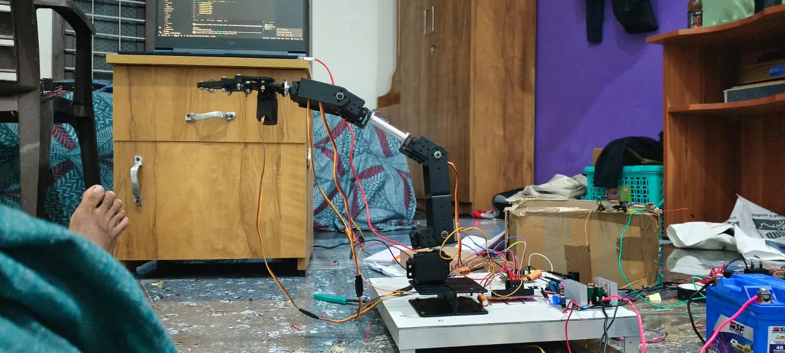
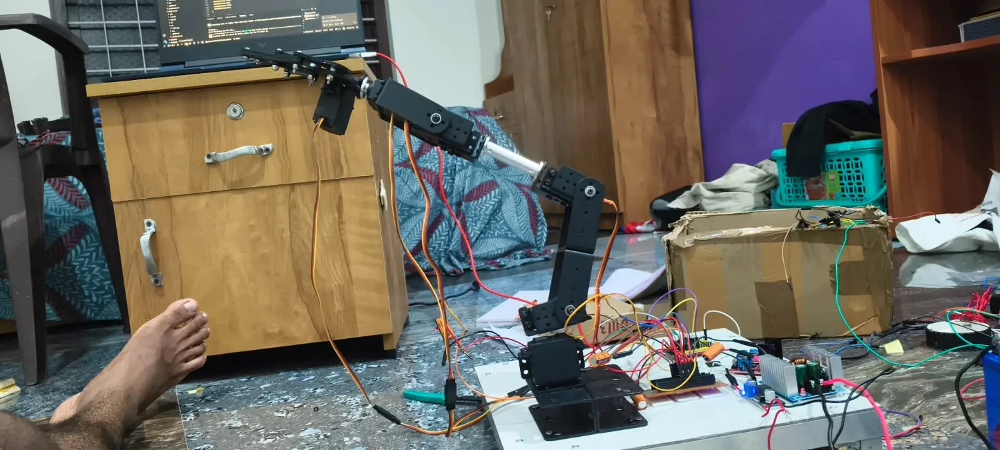
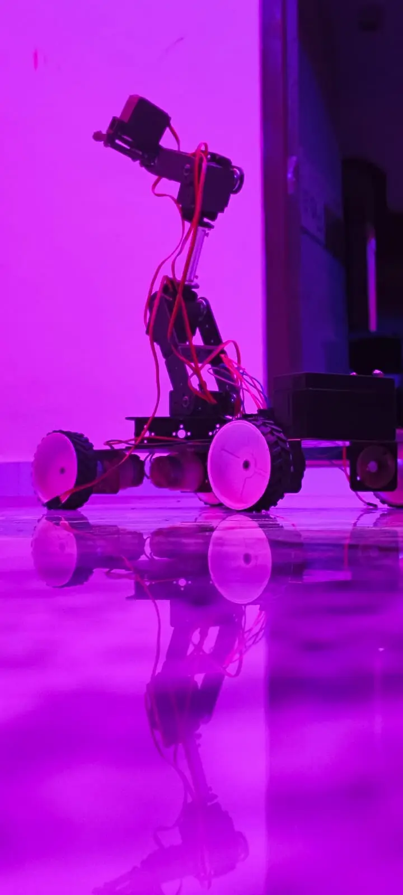
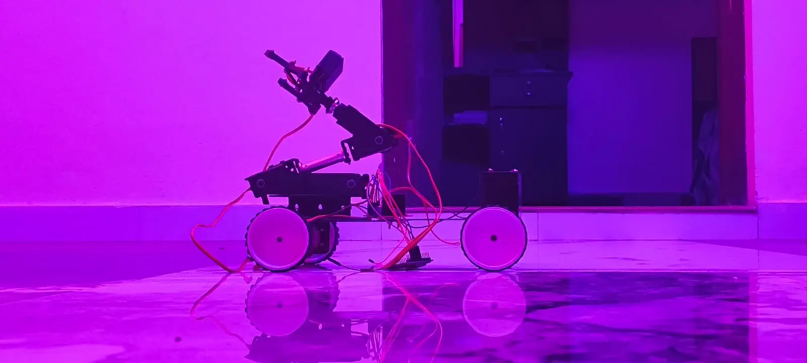
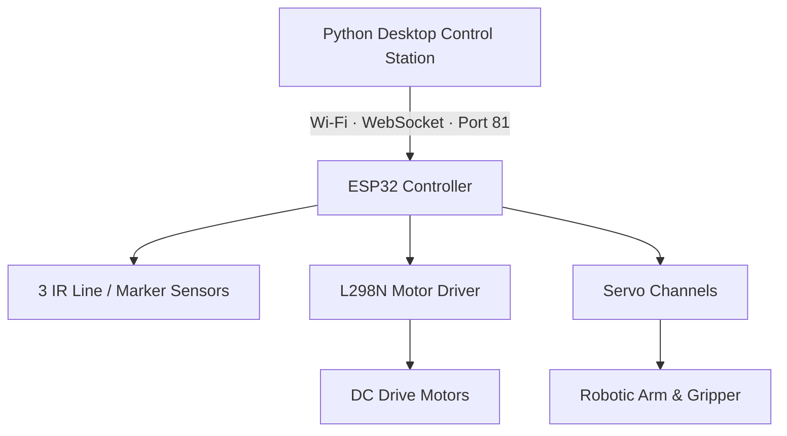

<div align="center">

# LIBA 🤖📚
### Library Intelligent Bot Assistant

**An autonomous mobile robot prototype for library book retrieval**

ESP32 · Line Following · Robotic Arm · Wi-Fi WebSocket · Python Desktop Control

</div>

---

> **Project status:** Prototype documentation and source code showcase. The repository includes the ESP32 firmware supplied for this project and a reconstructed Python desktop controller. The original desktop application source and demonstration video were unavailable. The controller has not been tested against the physical robot in this environment.

## Overview

LIBA is a mobile robotics prototype designed to demonstrate a book-retrieval workflow in a library-style environment. A desktop control station sends a retrieval command to an ESP32 over Wi-Fi. The robot follows a marked track, counts stop markers, operates a servo-based arm sequence at the selected shelf stop, and returns to its home position.

## Robot gallery

> Replace or reorder these images after confirming which photos represent the final build and early prototype.

<table>
<tr>
<td width="50%"><br><sub>Robot development — view 1</sub></td>
<td width="50%"><br><sub>Robot development — view 2</sub></td>
</tr>
<tr>
<td><br><sub>Prototype testing</sub></td>
<td><br><sub>Prototype — side view</sub></td>
</tr>
</table>

## Key features

- **Autonomous track navigation:** Three IR sensors detect the line and stop markers.
- **Stop-based destination selection:** The robot counts markers and targets a programmed shelf stop.
- **Robotic arm mechanism:** Servo-driven arm and gripper actions are sequenced by the ESP32.
- **Return-to-home behavior:** After the programmed shelf routine, the robot returns along the track.
- **Wireless control:** The desktop application communicates with the ESP32 using WebSocket over Wi-Fi.
- **Desktop control station:** Python/Tkinter interface for missions, robot status, arm controls, speed adjustment, telemetry, and emergency stop.

## System architecture



## Mission workflow

1. Robot begins at **Stop 1 — Home**.
2. The desktop sends a destination command such as `T1:2` or `T1:3`.
3. The ESP32 follows the track and counts stop markers.
4. At the selected stop, the programmed arm routine runs.
5. The robot reverses and navigates back to Home.
6. The home delivery routine runs and the controller reports the delivery status.

### Stop mapping in the current firmware

| Stop | Location |
|---|---|
| 1 | Home |
| 2 | Shelf 1 |
| 3 | Shelf 2 |

## Hardware

| Component | Role |
|---|---|
| ESP32 development board | Main embedded controller and Wi-Fi communication |
| 3 × IR sensors | Line tracking and marker detection |
| L298N motor driver | DC motor control |
| DC motors and wheels | Mobile platform |
| Servo motors | Arm, positioning, and gripper mechanism |
| Robotic arm and gripper | Book interaction mechanism |

> Refer to [`docs/HARDWARE_CONNECTIONS.md`](docs/HARDWARE_CONNECTIONS.md) for the pin mapping documented from the firmware. Confirm the wiring against the physical build before powering the system.

## Software stack

### Embedded firmware

- Arduino framework / PlatformIO
- ESP32
- ESP32Servo
- WebSockets library

### Desktop application

- Python
- Tkinter
- `websocket-client`

## Repository structure

```text
LIBA/
├── README.md
├── LICENSE_NOTE.txt
├── desktop_app/
│   ├── liba_desktop.py
│   ├── requirements.txt
│   └── README.md
├── firmware/
│   └── esp32/
│       ├── platformio.ini
│       ├── src/
│       │   ├── main.cpp
│       │   └── liba_secrets.example.h
│       └── historical firmware versions
├── docs/
│   ├── PROJECT_OVERVIEW.md
│   ├── HARDWARE_CONNECTIONS.md
│   └── DEVELOPMENT_TIMELINE.md
└── assets/
    └── development/
        └── project photos
```

## Run the desktop controller

### Requirements

- Python 3.9+
- Tkinter
- ESP32 firmware running and reachable on the same Wi-Fi network

### Install dependencies

```bash
cd desktop_app
python -m pip install -r requirements.txt
```

### Launch

```bash
python liba_desktop.py
```

Enter the ESP32 IP address shown in its serial output, then connect using the desktop application.

## Firmware setup

1. Install Visual Studio Code and the PlatformIO extension.
2. Open `firmware/esp32/` as the PlatformIO project.
3. Copy `src/liba_secrets.example.h` to `src/liba_secrets.h`.
4. Set your Wi-Fi credentials in the local secrets file.
5. Build and upload the firmware to the ESP32.
6. Open Serial Monitor and note the IP address.
7. Connect the desktop controller to the ESP32 at WebSocket port `81`.

`liba_secrets.h` is excluded from Git to prevent publishing local Wi-Fi credentials.

## Command reference

| Command | Action |
|---|---|
| `T1:2` | Retrieve from Stop 2 |
| `T1:3` | Retrieve from Stop 3 |
| `S` | Emergency stop |
| `H` | Home/reset arm |
| `1` | Arm to shelf position |
| `B1` | Extend arm |
| `R1` | Retract arm |
| `X` | Open gripper |
| `A=<angle>` | Manual servo control |
| `SPEED:<60–255>` | Adjust motor speed |

## Safety notes

- Test the emergency stop before autonomous operation.
- Keep the wheels lifted for initial motor tests.
- Keep the arm clear of people and pinch points.
- Use appropriately rated power supplies for motors and servos.
- Ensure grounds are common where required.
- Do not operate autonomous missions unattended.

## Limitations and verification status

- The desktop controller is a reconstruction based on the available firmware protocol; it is not the original application source.
- Physical robot testing was not possible during repository preparation.
- Verify multi-stop behavior and every motion sequence on the actual hardware before relying on it.
- Hardware pin mapping is documented from the firmware and should be checked against the build.
- Original demonstration video is unavailable.

## Documentation

- [Project overview](docs/PROJECT_OVERVIEW.md)
- [Hardware connections](docs/HARDWARE_CONNECTIONS.md)
- [Development timeline](docs/DEVELOPMENT_TIMELINE.md)
- [Desktop controller guide](desktop_app/README.md)
- [Firmware guide](firmware/esp32/README.md)

## Future improvements

- Add a verified demonstration video or GIF.
- Add a desktop application screenshot gallery.
- Confirm and label early-prototype versus final-build photos.
- Add a bill of materials and mechanical drawings, if available.
- Test and document the complete mission on the physical robot.

## License

The project currently has no selected open-source license. See [`LICENSE_NOTE.txt`](LICENSE_NOTE.txt). Until a license is added, do not assume the code is freely reusable.

---

<div align="center">

**Built as a robotics project exploring embedded control, autonomous navigation, and robotic manipulation.**

</div>
